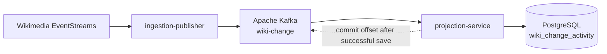

# Live Knowledge Feed

A hands-on event-driven architecture learning project built with Kotlin, Spring Boot, Apache Kafka, PostgreSQL, and Docker.

It ingests real-time Wikimedia recent changes, publishes them to a locally hosted Kafka broker, and builds a durable activity projection from the stream.

## Current flow



`projection-service` consumes Kafka records in batches, saves each event idempotently to PostgreSQL, and only then commits the Kafka offsets. On restart, it resumes from the committed offsets. If a database write fails, the batch is retried; duplicate delivery remains safe because PostgreSQL ignores an existing event ID.

## Modules

- `ingestion-publisher` — consumes Wikimedia's live SSE feed and publishes `WikiChange` events.
- `projection-service` — consumes Kafka events and writes the current activity projection.

## Direction

```text
PostgreSQL projection → later SAP HANA
Kafka → future search-indexer → Elasticsearch
Kafka → future archive consumer → object storage
```

## Local run

Run the complete local stack (Kafka, PostgreSQL, publisher, and projection):

```bash
docker compose up --build
```

Kafka UI is available at `http://localhost:8082`, and Kafka is available to host applications at `localhost:29092`. The `wiki-change` topic is created with three partitions. PostgreSQL uses `projection` as the default local password; override it with `POSTGRES_PASSWORD` in the root `.env` file if desired. The `.env` file is intentionally not committed.
